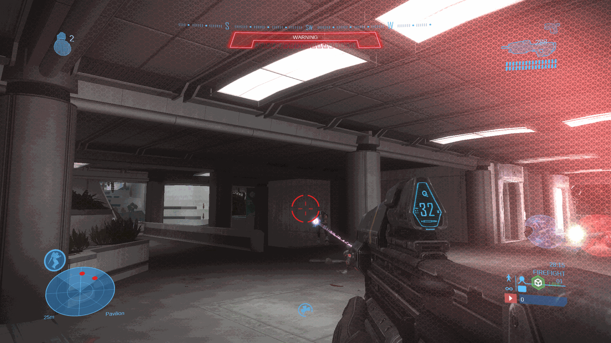
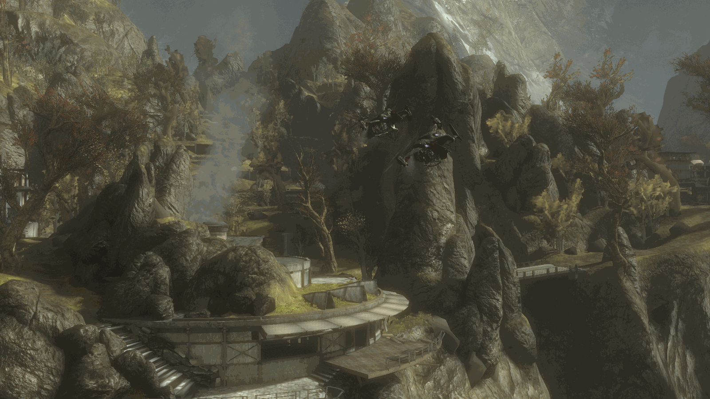
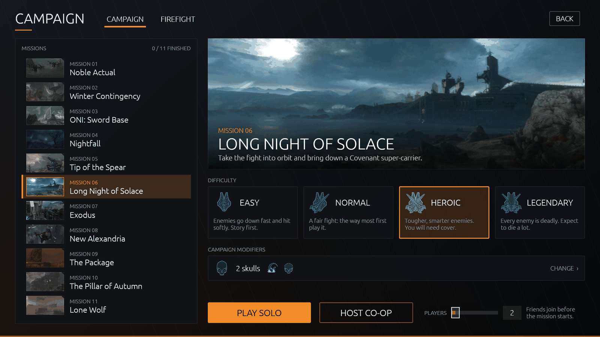

# Noble Outreach



A standalone community client for **Halo: Reach** on PC. Our own host program (`reach-host`) loads the game
engine (`haloreach.dll`) from **your own** copy of Halo: The Master Chief Collection and adds what the PC version
lost: hosting your own listen and dedicated servers, a server browser, Firefight and campaign co-op online,
Forge (solo or with friends, saving your own map variants), playlist voting, Spartan/Elite customisation and a
launcher that installs and updates everything.

> **Not affiliated with Microsoft, 343 Industries or Halo Studios.** Halo is their trademark. Noble Outreach is a
> non-commercial fan project. It ships no game files: every player needs a legitimate Steam copy of MCC with
> Halo: Reach installed. It never connects to official matchmaking and does not touch Easy Anti-Cheat.

## Screenshots
| | | |
|:-:|:-:|:-:|
| [](docs/screenshots/firefight-combat.png) | [](docs/screenshots/campaign-vista.png) | [](docs/screenshots/campaign-menu.png) |
| Firefight on Beachhead, Heroic | Campaign: Winter Contingency | The campaign screen: missions, difficulty, skulls |

## Requirements
- Halo: The Master Chief Collection on Steam, **build 2025.08.16** (`2025.08.16.178512.1`), with Halo: Reach
  installed. The client is pinned to that exact `haloreach.dll`; the launcher checks it and refuses other builds,
  because every engine address we use belongs to that build.
- Windows 10/11, or Linux x86_64 with [umu-launcher](https://github.com/Open-Wine-Components/umu-launcher)
  (Proton is downloaded automatically).

## Install and play
1. Download the launcher from the [releases](https://github.com/gelibeanz/noble-outreach/releases):
   `NobleOutreach-Launcher.exe` (Windows) or `NobleOutreach-Launcher-linux` (Linux, `chmod +x` it).
2. Run it. It finds MCC in your Steam libraries (or use *Browse...*), checks the build, and downloads the game
   client (`reach-host.exe`) from the latest GitHub release, verified against that release's `SHA256SUMS`. It
   updates itself the same way. If GitHub can't be reached, the installed client keeps working.
3. Type your player name and press **PLAY**.

There is no built-in server list. To find games, join a friend by address (*Server browser > Direct Connect*,
saved as a favourite), see games on your LAN, or add a master server someone runs in *Settings > Master server*.

Data lives in `%LOCALAPPDATA%\NobleOutreach` (Windows) or `~/.local/share/NobleOutreach` (Linux).
More detail: [notes/launcher-README.txt](notes/launcher-README.txt).

## Hosting
### Listen server (from the menu)
*Host game* starts a match on UDP 47800. Friends join with your address in *Direct Connect*. The host tries UPnP;
if that doesn't open the port, forward **UDP 47800** on your router (or use a UDP tunnel) and share the public
address. With a master server configured, the game is also listed there and NAT punching is tried.

### Dedicated server (Docker, Linux + NVIDIA GPU)
The engine needs a GPU even with nobody watching, so the server runs under Wine + DXVK in a hidden X display.
See [docker/](docker/):
```sh
cd docker
cp .env.example .env                 # set MCC_DIR (your MCC folder) and NVIDIA_VERSION
cp /path/to/reach-host.exe reach-server/   # from the release's server bundle, or your own build
docker compose up -d                 # add --profile firewall for the egress lockdown
```
It listens on UDP 47800. By default it isn't listed anywhere: players join by address. Set `REACH_MASTER` to list
it on a master server. Modes: Slayer, Firefight, campaign co-op, or a playlist from [playlists/](playlists/)
that players vote on.

On Windows you can run the server directly:
`reach-host.exe --dedicated --mcc "<MCC folder>" --map forge_world --max-players 16 --bind 0.0.0.0:47800
--server-name "My server" --hidden` (add `--master <url>` to list it).

### Run your own master server
`reach-master` is a small HTTP service: the server list for the browser, a UDP rendezvous for NAT punching, and
optionally client downloads for launchers. Run it with the Docker setup's `master` profile, or alone:
```sh
docker build -f src/reach-master/Dockerfile -t reach-master .
docker run -p 47880:47880 -p 47881:47881/udp reach-master
```
- Players add `http://<your host>:47880` (or an https URL in front of it) in *Settings > Master server*; servers
  list themselves with `--master <url>` (`REACH_MASTER` in Docker).
- Behind a reverse proxy or tunnel, start it with `--trust-proxy` so it sees players' real addresses.
- For NAT punching, publish UDP 47881 and set `REACH_MASTER_RENDEZVOUS_PUBLIC=<public host:port>`.
- To make your own builds update from your master instead of GitHub, serve a client folder with
  `--client-dir DIR` (`scripts/make-launcher.sh` stages one) and build with
  `NOBLE_UPDATE_SOURCE=master:<url>`. See [notes/launcher.md](notes/launcher.md) and
  [notes/master-server.md](notes/master-server.md).

## Build-time settings
- `NOBLE_UPDATE_SOURCE`: where the launcher updates from. `github:<owner>/<repo>` (default
  `github:gelibeanz/noble-outreach`, the latest release) or `master:<url>[,<url>...]`.
- `NOBLE_DEFAULT_MASTERS`: master list reach-host uses when the player hasn't set one (default: none).

## Building
Rust (stable) plus [cargo-zigbuild](https://github.com/rust-cross/cargo-zigbuild) and zig to cross-compile:
```sh
cargo zigbuild --release --target x86_64-pc-windows-gnu -p reach-host          # game client / dedicated server
cargo zigbuild --release --target x86_64-pc-windows-gnu -p reach-launcher      # Windows launcher
cargo zigbuild --release --target x86_64-unknown-linux-gnu.2.31 -p reach-launcher   # Linux launcher
cargo zigbuild --release --target x86_64-unknown-linux-musl -p reach-master    # master server
cargo test -p reach-master -p reach-launcher
```
Releases are built by [.github/workflows/release.yml](.github/workflows/release.yml) when a `v*` tag is pushed.

## Layout
- `src/reach-host`: the host program (engine host, networking, menus, server browser, dedicated server).
- `src/reach-launcher`: the launcher (Windows/Linux).
- `src/reach-master`: the master server.
- `src/reach-tracer`: a proxy `haloreach.dll` that logs how MCC drives the engine (research tool).
- `notes/`: engine interface notes (addresses for the pinned build, in our own words) and design notes.
- `docker/`: dedicated server, firewall and master as a compose stack.

## Credits
- Inspired by **Project Reclaimer**, the community's standalone Halo 3 client. Noble Outreach is a separate
  project and shares no code with it.
- Thanks to the Halo PC modding and reverse-engineering community, whose public research on MCC and the Reach
  engine pointed the way.

## License
[GPL-3.0](LICENSE). Contributions: see [CONTRIBUTING.md](CONTRIBUTING.md).
